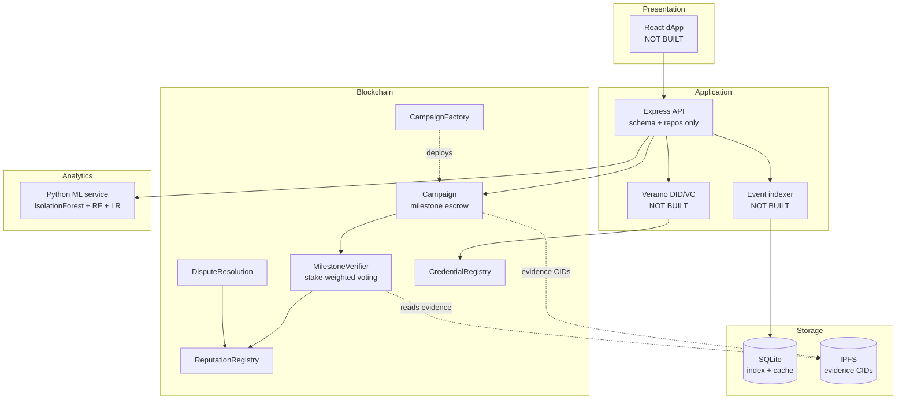

# Blockchain-Based Trust Management for Crowdfunding

A milestone-escrow crowdfunding framework with verifiable identity, on-chain reputation,
and stake-weighted dispute resolution, built as a B.Tech CSE final-year project.

> **Read this first.** Parts of this repository are complete and measured; parts are
> stubs. The [Project Status](#project-status) section says exactly which is which, and
> every number in this README was produced by a script in this repository rather than
> estimated. Nothing is reported that was not run.

---

## Project Status

Honest accounting of what exists, what was measured, and what was not.

| Objective | Status | Evidence |
|---|---|---|
| **O1** Milestone escrow with automated release and refunds | **Done** | `Campaign.sol`, 14 lifecycle tests covering success, failed funding, pro-rata refunds, rejected milestone |
| **O2** Benchmark gas/latency/throughput on L1 vs L2 | **Partial** | Harness runs and produces CSV/JSON. Gas is **measured**. Live testnet gas prices are **fetched**. **No deployment to any testnet has occurred** — no funded key — so there are no real cross-network latency/throughput figures. L1-vs-L2 USD cost is a *model* under stated assumptions, not a measurement. |
| **O3** Milestone verification via IPFS evidence + verifier voting + oracle | **Done (contract level)** | `MilestoneVerifier.sol`: stake-weighted voting, quorum snapshot, oracle adapter. IPFS upload path exists in the backend; **no Pinata credential has been configured**, so pinning is untested against a live service. |
| **O4** Reputation model + anomaly detection | **Done (with caveat)** | `ReputationRegistry.sol` on-chain, verified byte-exact against a Python mirror. ML service trains and scores. **The ML data is synthetic**, so its metrics measure recovery of injected signal, not real-world fraud detection. |
| **O5** Dispute resolution with stake-weighted voting and automatic refunds | **Done** | `DisputeResolution.sol`, 29 tests. Bonds, quadratic/linear weight curve, cooldown, juror slashing. |

### Not built

| Component | Status |
|---|---|
| Backend API routes, indexer, Veramo agent | **Partial** — schema, migrations, and repository layer are complete and tested (21 tests). Routes, indexer, and Veramo are not written. |
| React dApp | **Not built** |
| Docker Compose | **Written, not executed** — images were never built in this environment |
| User study | **Instrument and analysis pipeline only.** No participants were recruited; all survey data is synthetic and stamped as such. |
| Formal verification | **None.** All assurance comes from tests and static analysis. |

---

## Quick start

```bash
# 1. Contracts
npm install --legacy-peer-deps
npx hardhat compile
npx hardhat test

# 2. Coverage and gas
npx hardhat coverage
REPORT_GAS=true npx hardhat test

# 3. Deploy locally
npx hardhat node                       # terminal 1
npx hardhat run scripts/deploy.ts      # terminal 2 (local network)

# 4. Backend
cd backend && npm install && npm run migrate && npm test

# 5. ML service
python -m pip install -r ml-service/requirements.txt
python ml-service/data_generation.py
python ml-service/train.py
python ml-service/plot_results.py
python ml-service/ml_service_api.py    # http://127.0.0.1:8000/docs

# 6. Optional: services in Docker
docker compose up --build
```

Copy `.env.example` to `.env` before anything that touches a real network.

---

## Architecture



### Trust flows

**Milestone verification.** Creator pins evidence to IPFS and submits `(CID, keccak256)` on chain. The verifier registry records stake-weighted votes during a window; `Campaign.resolveMilestone` calls `settleRound`, and only an `Approve` outcome releases the tranche. Quorum failure resolves as **Reject** — the escrow fails closed.

**Disputes.** A backer posts a bond to contest a milestone. Jurors vote by stake with a configurable linear or quadratic curve. Resolution routes the unreleased balance, returns or slashes bonds, and updates reputation.

---

## Measured results

All figures below were produced by scripts in this repository and are reproducible.
Raw output is committed under `benchmarks/results/`, `evaluation/results/`,
`ml-service/models/metrics.json`, and `security/`.

### Gas (local EVM, measured)

| Operation | Gas (median) |
|---|---|
| `CampaignFactory.createCampaign` | 2,426,705 |
| `Campaign.submitEvidence` | 164,194 |
| `Campaign.resolveMilestone` | 159,723 |
| `MilestoneVerifier.castVote` | 97,697 |
| `Campaign.claimRefund` | 79,156 |
| `Campaign.claimCreatorBalance` | 56,786 |
| `Campaign.closeFunding` | 42,193 |

**The finding that matters:** at the stated assumption of 10 gwei and $2,500/ETH,
`createCampaign` costs roughly **$60**, which is about **12× a $5 contribution**. Creating
a campaign on L1 is not viable for small campaigns. This is a real design signal, not a
tuning artifact, and it is why the L2 comparison exists.

### L1 vs L2

`benchmarks/compare-l1-l2.ts` combines **measured** execution gas with **live**
`eth_gasPrice` and **assumed** token prices.

The script **refuses to emit a comparison** when a live gas price is implausible.
Sepolia has served <0.001 gwei, which would have produced a nonsensical "$606,755 to
create a campaign". That guard is a deliberate correctness check: producing no number is
better than producing a wrong one that looks authoritative.

Three caveats that apply to every figure the script prints:

1. Execution gas is measured locally; it has **not** been confirmed by deploying to
   either network.
2. L2 cost here **excludes** the L1 data-availability charge for calldata, which on
   rollups is frequently the dominant term. L2 figures are optimistically low.
3. USD conversion rests on operator-supplied token prices, which are assumptions.

### ML (synthetic data — read the caveat)

| Model | Precision | Recall | F1 | ROC-AUC |
|---|---|---|---|---|
| Isolation Forest (unsupervised) | 0.593 | 0.594 | 0.593 | 0.661 |
| Random Forest | 0.973 | 0.980 | 0.977 | 0.998 |
| Logistic Regression | 0.918 | 0.924 | 0.921 | 0.985 |

**These numbers describe a synthetic generator, not real crowdfunding fraud.** The first
version of the generator used disjoint feature ranges per class and produced a perfect
1.0 F1 across every model. That result measured the generator, not any signal, and it was
discarded. The corpus now overlaps deliberately and injects 4% label noise.

Isolation Forest performing near chance is the **useful** result: it never sees a label,
which is the condition it will actually face on new campaigns.

### Attack simulations

Run by `evaluation/attack-simulations.ts`; output in `evaluation/results/`.

| Scenario | Outcome |
|---|---|
| Sybil staking vs 5 honest verifiers | Attacker needed 6–8 funded identities (6–8 ETH) to flip the round. Identity count alone confers no influence; each sybil costs slashable capital. |
| Creator + 2 colluding verifiers vs 3 honest | Collusion **failed**. 0 wei released; colluders' dissent slashed 0.2 ETH each. |
| Dispute griefing | 1 dispute opened, 2 blocked by the per-campaign cooldown, 0.05 ETH locked. |

---

## Security

`slither` (102 detectors) reports **0 High** findings. Two High findings were found and
fixed; both are documented with root-cause analysis in
[`security/SLITHER_REPORT.md`](security/SLITHER_REPORT.md).

| ID | Finding | Severity | Disposition |
|---|---|---|---|
| H1 | `sweepDust(address)` sent ETH to a **caller-supplied** destination while its NatSpec claimed the opposite | High | Fixed — parameter removed, `treasury` is immutable |
| H2 | `settleJuror`: CEI violation, no reentrancy guard, and a reward of `totalBondEscrow / 100` per juror — letting a juror in N disputes drain ~N% of the pool | High | Fixed — `nonReentrant`, CEI ordering, pro-rata by weight from the dispute's own bond |

Each fix has a regression test in `test/Security.regression.test.ts` that fails if the
fix is reverted.

Remaining Medium findings are triaged individually in `security/SLITHER_REPORT.md` with
reasons for acceptance. The threat model is in
[`security/THREAT_MODEL.md`](security/THREAT_MODEL.md), which also lists five risks the
system explicitly does **not** solve (stake concentration, vote front-running, oracle
trust, admin key compromise, and the absence of formal verification).

---

## Objective → Implementation → Evidence

| Objective | Module | Proof |
|---|---|---|
| **O1** Milestone escrow | `contracts/Campaign.sol` | `test/Campaign.lifecycle.test.ts` — 14 tests: full success path, failed funding, pro-rata refund, rejected milestone, double-claim refusal |
| **O2** L1 vs L2 benchmarking | `benchmarks/run-benchmarks.ts`, `benchmarks/compare-l1-l2.ts` | `benchmarks/results/` — measured gas; comparison carries a self-label and explicit assumptions |
| **O3** Evidence + voting + oracle | `contracts/MilestoneVerifier.sol`, `contracts/interfaces/IOracleAdapter.sol` | `test/MilestoneVerifier.test.ts` (11), `test/Campaign.security.test.ts` (12) — quorum, double-vote, oracle access control |
| **O4** Reputation + anomaly detection | `contracts/ReputationRegistry.sol`, `ml-service/` | `test/ReputationRegistry.test.ts` — 10 tests incl. **exact on-chain/off-chain parity**; `ml-service/models/metrics.json` |
| **O5** Dispute resolution | `contracts/DisputeResolution.sol` | `test/DisputeResolution.test.ts` (13) + `test/DisputeResolution.coverage.test.ts` (15) |
| Security | Slither + threat model | `security/SLITHER_REPORT.md`, `security/THREAT_MODEL.md` |
| Attack analysis | Simulations | `evaluation/results/attack-simulations.json` |
| Usability study | Instrument + analysis | `evaluation/survey/` — pipeline validated on **synthetic** data; **no study run** |

---

## Test and coverage summary

```
Solidity   103 tests passing   88.7% line coverage
           Campaign 89.2% | MilestoneVerifier 83.9% | Reputation 94.8%
           CampaignFactory 96.3% | DisputeResolution 96.3% | CredentialRegistry 77.4%

Backend    21 tests passing    (repositories, idempotency, reorg rollback, FK cascade)
```

Coverage is below the 90% target in the brief. The gap is concentrated in
`CredentialRegistry` (77.4%) and untested `view` branches.

---

## Repository layout

```
contracts/            Solidity: escrow, verifier, reputation, disputes, credentials
test/                 Hardhat suites (unit, lifecycle, security, regression)
scripts/deploy.ts     Deployment + permission wiring
benchmarks/           Gas harness + L1-vs-L2 comparison
evaluation/           Attack simulations, survey instrument, survey analysis
security/             Slither report + triage, STRIDE threat model
ml-service/           Data generation, training, FastAPI, reputation mirror, plots
backend/src/db/       Schema, migrations, repository layer (+ tests)
docs/                 DECISIONS.md, THREAT_MODEL (symlink-free copies in security/)
```

---

## Documentation

- [`docs/DECISIONS.md`](docs/DECISIONS.md) — every significant decision, including the
  Hardhat 3 → 2 downgrade, `better-sqlite3` → `node:sqlite`, and the SQLite → PostgreSQL
  path with its real limits
- [`security/SLITHER_REPORT.md`](security/SLITHER_REPORT.md) — findings, fixes, and
  justified acceptances
- [`security/THREAT_MODEL.md`](security/THREAT_MODEL.md) — STRIDE analysis
- [`evaluation/survey/instrument.md`](evaluation/survey/instrument.md) — study instrument

## License

MIT